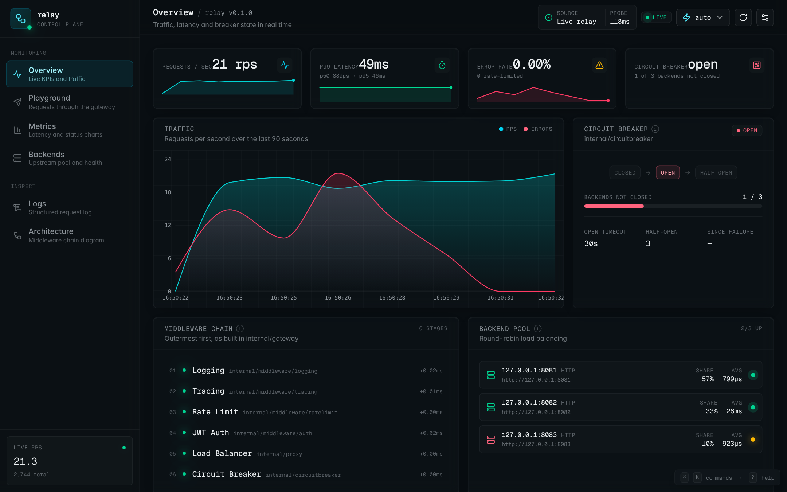
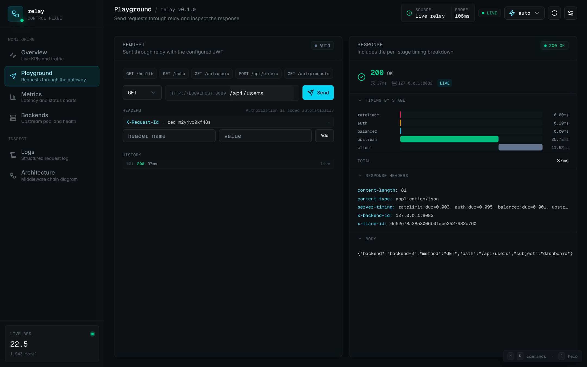
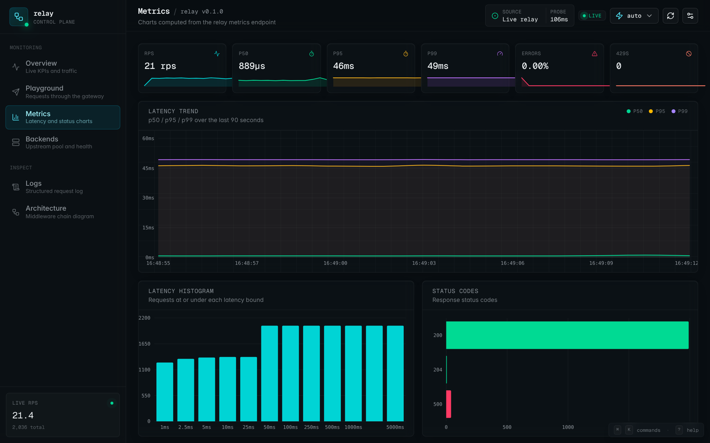
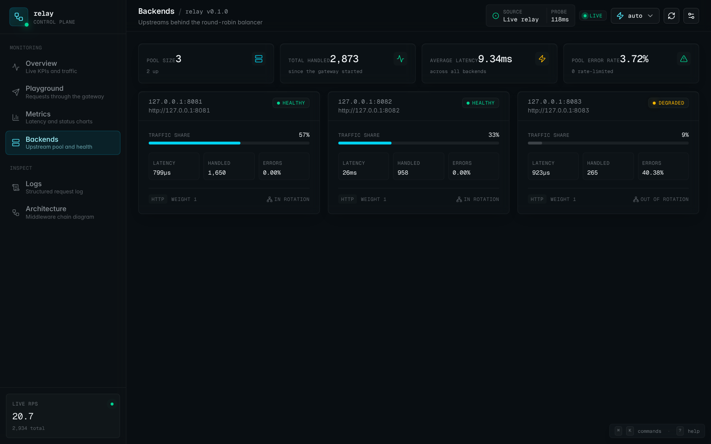
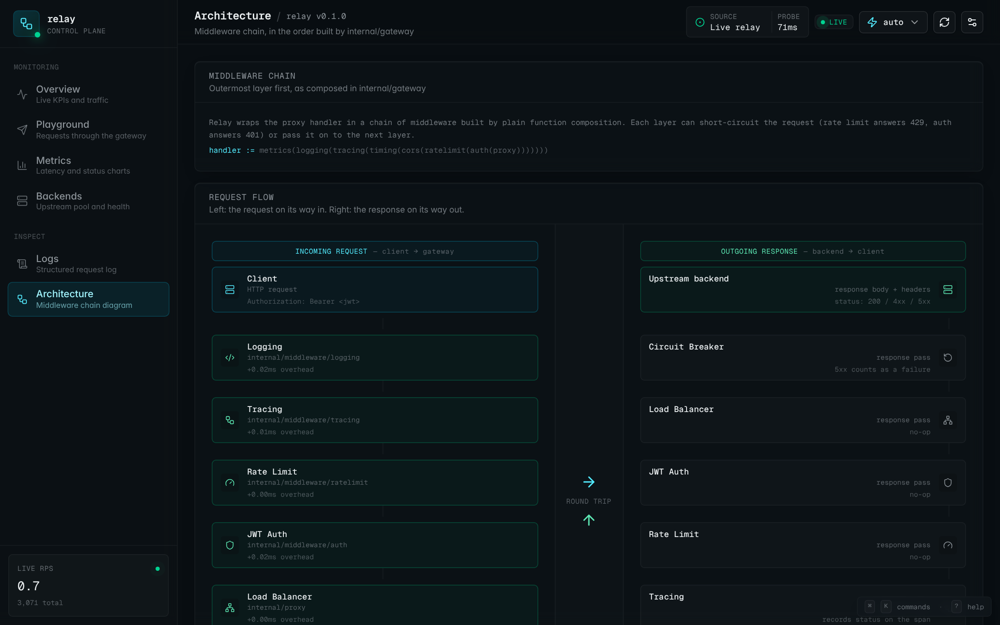

# Relay — API gateway in Go

[](https://github.com/Imronaxl/go-api-gateway/actions/workflows/backend.yml)
[](https://github.com/Imronaxl/go-api-gateway/actions/workflows/frontend.yml)

Relay is a reverse proxy that sits in front of a pool of HTTP services. It
verifies JWTs, rate-limits clients, balances load across healthy backends,
isolates failing backends with circuit breakers, and exports metrics, traces
and structured logs. A Next.js dashboard shows the gateway's live state.



## Features

- **JWT verification (HS256)** with the standard library: constant-time
  signature check, `exp`/`nbf` with leeway, `alg: none` rejected. The subject
  is forwarded to upstreams as `X-Auth-Subject`; a client-supplied value is dropped.
- **Per-client token-bucket rate limiting** keyed by IP (port stripped,
  `X-Forwarded-For` only when trusted), `Retry-After` computed from the bucket,
  idle buckets evicted.
- **Round-robin load balancing** over backends that pass active health checks.
- **A circuit breaker per backend** (closed → open → half-open). Transport
  errors and 5xx responses count as failures, so one bad instance is taken out
  of rotation without affecting the others.
- **Observability**: Prometheus metrics, OpenTelemetry traces with W3C context
  propagated to upstreams, one JSON log line per request, and a
  `Server-Timing` header with the time spent in each stage.
- **Optional Kafka audit log**: one event per request, published
  asynchronously; events are dropped and counted rather than blocking requests.
- **Graceful shutdown** of both listeners, the audit publisher and the tracer.

## Architecture

```
client ─► metrics ─► logging ─► audit ─► tracing ─► timing ─► CORS ─► rate limit ─► JWT ─► pool
                                                                                              │
                                                            round robin over healthy backends │
                                                            whose breaker admits the request  ▼
                                                                                backend-1 … backend-N
```

| Package | Responsibility |
|---|---|
| `internal/gateway` | Builds the middleware chain and routes |
| `internal/proxy` | Backend pool: `httputil.ReverseProxy` per backend, health checks, selection |
| `internal/circuitbreaker` | Breaker state machine with a state-change hook |
| `internal/middleware/auth` | HS256 verification and token signing (used by `cmd/tokengen`) |
| `internal/middleware/ratelimit` | Token bucket per client on `golang.org/x/time/rate` |
| `internal/middleware/{logging,tracing,cors}` | Request log, OpenTelemetry span, CORS for the dashboard |
| `internal/timing` | `Server-Timing` header from stage marks |
| `internal/metrics` | Prometheus collectors on a private registry |
| `internal/audit` | Buffered Kafka publisher |
| `internal/config` | Environment configuration, validated up front |
| `web/` | Next.js dashboard |

### Design decisions

- **Rate limit before auth.** Verifying a signature costs more than taking a
  token, and a client sending garbage tokens should still run out of budget.
- **Breakers per backend, not one global breaker.** A single breaker would
  open for everyone when one instance fails. Per-backend breakers let the
  balancer route around it.
- **JWT on the standard library.** HS256 is a few lines of `crypto/hmac`; the
  interesting part is what to reject (`none`, other algorithms, expired and
  not-yet-valid tokens), which the tests cover.
- **One response-writer wrapper.** Metrics, logging, tracing and timing share
  `httpx.ResponseWriter` instead of wrapping the writer four times. It
  implements `Unwrap`, so `ReverseProxy` can still flush streamed responses.
- **Client disconnects do not count against a backend.** If the request
  context is cancelled, the breaker is left untouched.

## Quick start

With Docker:

```bash
cd deploy
docker compose up --build
```

| Service | URL |
|---|---|
| Gateway | http://localhost:8080 |
| Gateway metrics | http://localhost:9090/metrics |
| Prometheus | http://localhost:9091 |
| Grafana (provisioned dashboard) | http://localhost:3001 |
| Jaeger | http://localhost:16686 |

Compose starts three demo backends; `backend-3` fails 40% of requests so the
circuit breaker has something to do. Add `--profile audit` and
`RELAY_KAFKA_BROKERS=kafka:9092` to enable the Kafka audit log.

Send a request:

```bash
TOKEN=$(go run ./cmd/tokengen -secret local-dev-secret-change-me -sub alice)
# or, without Go installed:
# TOKEN=$(docker compose run --rm --entrypoint /app/tokengen relay -secret local-dev-secret-change-me -sub alice)

curl -i -H "Authorization: Bearer $TOKEN" localhost:8080/api/users
# HTTP/1.1 200 OK
# Server-Timing: ratelimit;dur=0.002, auth;dur=0.021, balancer;dur=0.001, upstream;dur=0.512, total;dur=0.548
# X-Backend-Id: backend-1:8081
# X-Trace-Id: 4bf92f3577b34da6a3ce929d0e0e4736
# {"backend":"backend-1","method":"GET","path":"/api/users","subject":"alice"}

curl -s -H "Authorization: Bearer $TOKEN" localhost:8080/_relay/status   # backend health and breaker states
curl -i localhost:8080/api/users                                          # 401
```

Without Docker:

```bash
PORT=8081 go run ./demo-backends/rest &
PORT=8082 go run ./demo-backends/rest &
RELAY_BACKENDS=http://localhost:8081,http://localhost:8082 \
RELAY_JWT_SECRET=local-dev-secret-change-me \
go run ./cmd/relay
```

Dashboard:

```bash
cd web
bun install
bun run dev   # http://localhost:3000
```

It connects to the gateway on `:8080` when it is running and falls back to a
built-in simulator otherwise.

## Configuration

| Variable | Default | |
|---|---|---|
| `RELAY_BACKENDS` | required | Comma-separated upstream URLs |
| `RELAY_JWT_SECRET` | required | HS256 secret, at least 16 characters |
| `RELAY_LISTEN_ADDR` / `RELAY_METRICS_ADDR` | `:8080` / `:9090` | |
| `RELAY_RATE_LIMIT_RPS` / `RELAY_RATE_LIMIT_BURST` | `100` / `50` | Per client |
| `RELAY_TRUST_FORWARDED_FOR` | `false` | Key clients by `X-Forwarded-For` |
| `RELAY_BREAKER_MAX_FAILURES` | `5` | Consecutive failures that open a breaker |
| `RELAY_BREAKER_OPEN_TIMEOUT` | `30s` | Time before probes are let through |
| `RELAY_BREAKER_HALF_OPEN_REQUESTS` | `3` | Successful probes needed to close |
| `RELAY_HEALTH_PATH` / `RELAY_HEALTH_INTERVAL` | `/health` / `5s` | Active health checks |
| `RELAY_UPSTREAM_TIMEOUT` | `30s` | Time to upstream response headers (504 after) |
| `RELAY_CORS_ORIGINS` | empty | Origins allowed to call the gateway from a browser |
| `RELAY_KAFKA_BROKERS` / `RELAY_KAFKA_TOPIC` | empty / `relay.audit` | Enables the audit log |
| `OTEL_EXPORTER_OTLP_ENDPOINT` | empty | Enables trace export over OTLP/gRPC |

Invalid values are reported together at startup.

## Metrics

| Metric | Labels |
|---|---|
| `relay_http_requests_total` | `method`, `code`, `backend` |
| `relay_http_request_duration_seconds` (histogram) | `backend` |
| `relay_http_requests_in_flight` | |
| `relay_ratelimit_rejected_total` | |
| `relay_auth_rejected_total` | `reason` (`missing`, `expired`, `signature`, `malformed`) |
| `relay_upstream_errors_total` | `backend` |
| `relay_backend_up` | `backend` |
| `relay_circuit_breaker_state` (0 closed, 1 open, 2 half-open) | `backend` |

## Testing

```bash
go test -race ./...    # 46 tests, 86% statement coverage of internal/
cd web && bun test     # dashboard data mapping and simulator
```

The tests use fake clocks for the breaker, rate limiter and JWT expiry, and
`httptest` servers for the proxy: round robin, a breaker isolating a failing
backend, 502 on connection errors, 504 on upstream timeouts, health-check
transitions, and spoofed `X-Auth-Subject` headers. `internal/gateway` runs the
full chain end to end.

Benchmark on a 2-vCPU VM (client, gateway and backend on the same machine):

```
$ go test -run=NONE -bench=. -cpu=2 ./internal/gateway/
BenchmarkPipeline-2   39349   88874 ns/op   # through the gateway
BenchmarkDirect-2    166377   19153 ns/op   # straight to the backend
```

Most of the difference is the extra HTTP hop. The stages inside the gateway
(rate limit, JWT check, backend selection) add well under 0.1 ms according to
`Server-Timing`.

## Dashboard

| | |
|---|---|
|  |  |
|  |  |

In live mode the dashboard computes RPS, error rate and latency percentiles
from two consecutive scrapes of `/metrics` (with the same interpolation as
PromQL's `histogram_quantile`), reads backend state from `/_relay/status`, and
shows request timings from the gateway's `Server-Timing` header.

## License

MIT
